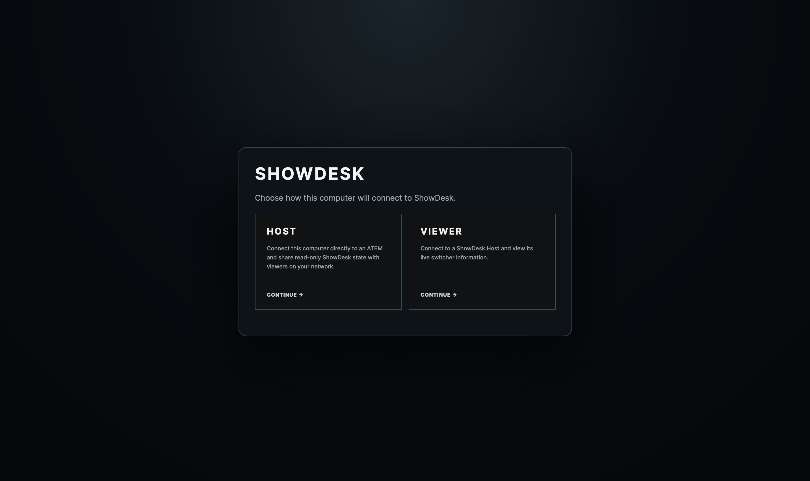
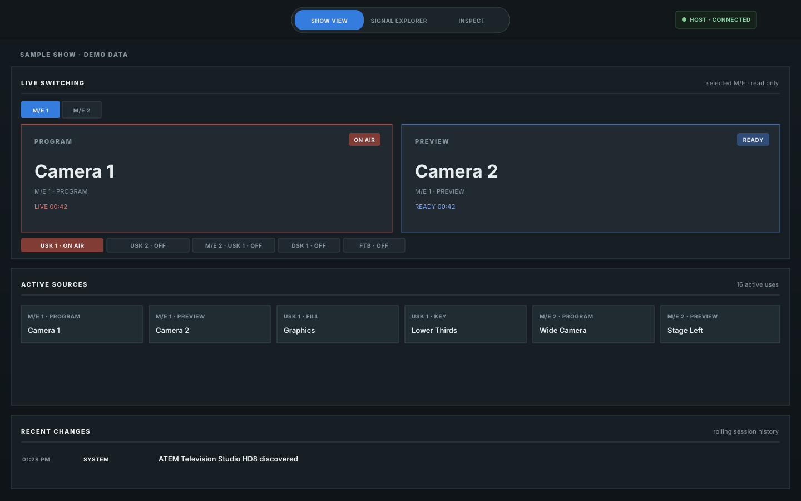
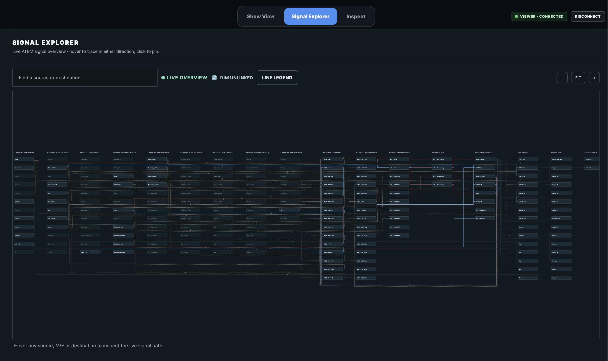
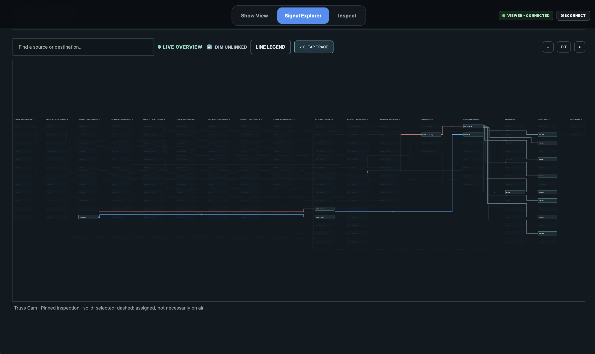
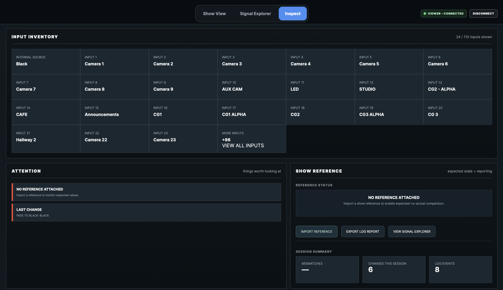
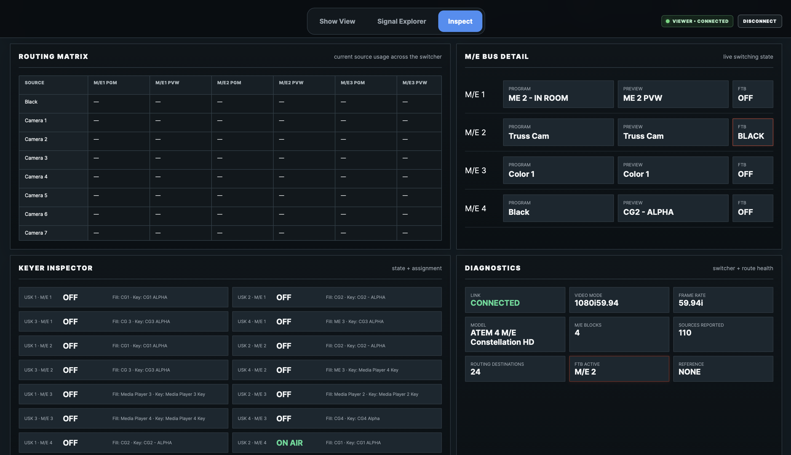
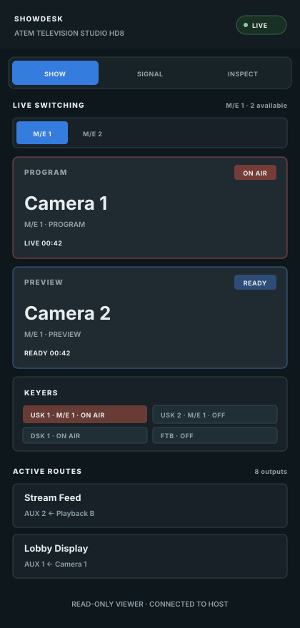

# ShowDesk

**See what your ATEM is doing at a glance.** ShowDesk is a read-only companion for live-production teams: follow program and preview across M/Es, trace signal routes, and spot switcher details without digging through control menus.

[](https://github.com/DrewL33/ShowDesk/releases/latest)

<p align="center">
  <a href="https://github.com/DrewL33/ShowDesk/releases/latest/download/ShowDesk-macOS-Installer.dmg"><strong>Download for macOS (Apple silicon)</strong></a>
  &nbsp; · &nbsp;
  <a href="https://github.com/DrewL33/ShowDesk/releases/latest/download/ShowDesk-Windows-Installer.exe"><strong>Download for Windows (x64)</strong></a>
  &nbsp; · &nbsp;
  <a href="https://github.com/DrewL33/ShowDesk/releases/latest">All releases</a>
</p>

## Try ShowDesk Beta

Beta builds are available for early feature testing and install as a separate **ShowDesk Beta** app. Beta uses its own update feed and does not replace or update the stable ShowDesk app. Beta updates are published from the `beta` branch.

- [Download ShowDesk Beta for macOS (Apple silicon)](https://github.com/DrewL33/ShowDesk/releases/download/showdesk-beta-latest/ShowDesk-Beta-macOS-Installer.dmg)
- [Download ShowDesk Beta for Windows (x64)](https://github.com/DrewL33/ShowDesk/releases/download/showdesk-beta-latest/ShowDesk-Beta-Windows-Installer.exe)
- [View Beta release details](https://github.com/DrewL33/ShowDesk/releases/tag/showdesk-beta-latest)



## See the whole signal path

ShowDesk turns live switcher state into a clear operational view. It reads the ATEM directly in Host Mode, or connects as a read-only desktop or phone Viewer to a ShowDesk Host.

- **Show View** — choose an M/E and keep program, preview, active sources, keyers, and recent changes in view.
- **Signal Explorer** — trace sources through M/E program and preview buses, keyers, AUX buses, and routed destinations. Search and pin a path to follow it.
- **Inspect** — review input inventory, attention items, routing matrix, M/E bus details, keyer state, video mode, and connection diagnostics.
- **Show references** — compare supported routing and configuration values with the live switcher and surface mismatches.
- **Session reports** — export a readable record of connection health and the switcher state observed during the session.
- **Phone and tablet Viewer** — open a compact, read-only Show, Signal, and Inspect interface served by the Host.
- **Signed in-app updates** — check for the current release from Settings and install when ready.

## Product screenshots

The Show View and mobile Viewer illustrations use sample show data. Signal Explorer and Inspect below are real app screenshots; source names, routing, and switcher state reflect the connected system at capture time.

### Show View

Program and preview, active sources, and keyer state for the selected M/E.



### Signal Explorer

Trace the live source-to-destination graph across M/E buses, key assignments, processors, internal outputs, and destinations. The pinned view highlights one path while dimming unrelated routes.





### Inspect

Review the input inventory, attention and reference status, and session summary. The lower workspace contains the routing matrix, live M/E bus state, keyer assignments, and switcher diagnostics.





### Mobile Viewer

The Host serves a compact mobile page directly on the production network.



## Install

1. Download the installer for your computer from the buttons above.
2. Open the disk image on macOS and move ShowDesk to Applications, or run the Windows installer.
3. Open ShowDesk and choose **Host** to connect directly to an ATEM, or **Viewer** to connect to a computer already running ShowDesk Host.

ShowDesk 1.0 currently ships for Apple silicon Macs and 64-bit Windows. macOS and Windows may show their standard first-run warning for an independently distributed app. Download only from this repository’s Releases page.

## Use the mobile Viewer

Start ShowDesk in **Host** mode, then open this address on a phone or tablet connected to the same LAN or VPN:

```text
http://<host-computer-ip>:47822/
```

The page connects to the Host automatically. Allow inbound TCP port **47822** through the Host computer’s firewall. The mobile Viewer is read-only and does not connect directly to or control the ATEM.

For a ShowDesk Beta Host, open `http://<host-computer-ip>:47832/` and allow inbound TCP port **47832**. Stable and Beta use separate ports so both apps can run on the same computer.

For a desktop Viewer, open ShowDesk, choose **Viewer**, and enter the Host computer’s IP address. Host and Viewer can communicate over a LAN or a properly routed VPN. The Host’s local ATEM connection remains on the Host computer.

## Supported switchers and connection

ShowDesk uses the ATEM network protocol through the `atem-connection` library. Connect the Host computer to the same network as the switcher and enter the switcher’s IP address. Feature availability depends on the model and the state reported by the ATEM; ShowDesk displays data it can verify and labels unsupported or unavailable values accordingly.

The app does not issue switcher control commands. The desktop Host connects to the ATEM; mobile and desktop Viewers receive read-only state from that Host.

## Updates and support

ShowDesk can check its signed GitHub update feed at launch and from **Settings → Updates**. Automatic checks can be turned off. ShowDesk asks before downloading an update.

Report a problem or request a feature in [GitHub Issues](https://github.com/DrewL33/ShowDesk/issues). Include your ShowDesk version, operating system, switcher model, and a description of what you expected to happen. Remove private show names, IP addresses, or other production details from any report or attachment.

## Project

- [Download the latest release](https://github.com/DrewL33/ShowDesk/releases/latest)
- [View release notes](https://github.com/DrewL33/ShowDesk/releases)
- [Report an issue](https://github.com/DrewL33/ShowDesk/issues)
